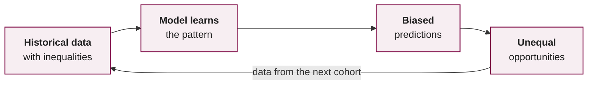

<!--
author:    Dr. Hannes Tegelbeckers
email:     hannes.tegelbeckers@ovgu.de
version:   1.2.1
language:  en
narrator:  UK English Female
mode:      Textbook

title:     S02 – Introduction to AI & Prompting II: tools, limitations, ethics (Self-learning unit)
comment:   AI in TVET I – Self-learning unit for session 2 (22.10.2026): AI tools and prompt patterns, limitations of generative AI, human-centred mindset and ethics of AI in education.

import:    https://raw.githubusercontent.com/LiaTemplates/mermaid_template/0.1.4/README.md
-->

# S02 – Introduction to AI & Prompting II

> **Session 2 · 22.10.2026 · 🔵 Self-learning** – I am travelling; work through this unit on your own.
>
> **Time needed:** about 2.5–3 hours
>
> **Do the exercise in Moodle by 28.10.2026, 23:59** – see the last chapter: [Open the exercise in Moodle](https://elearning.ovgu.de/mod/scorm/view.php?id=702179)

**After this unit you will be able to …**

1. choose suitable AI tools for discussion, research and content creation,
2. apply prompt patterns to TVET tasks,
3. recognise typical limitations of generative AI and verify AI output,
4. explain the human-centred mindset and key ethical risks of AI in education,
5. relate these risks to the EU AI Act and the UNESCO AI Competency Framework for Teachers.

## 1. Choosing the Right Tool

Different tools are built for different jobs. Use the tool that fits your task – and document it in your AI tools log.

| Purpose | Tools (examples) | Strength | Watch out |
| --- | --- | --- | --- |
| Discussion, drafting, structuring | ChatGPT, Claude, Gemini, Copilot | Flexible, good at language and structure | Can invent facts and references |
| Research with sources | Perplexity, Consensus, Elicit | Show sources; Consensus searches peer-reviewed papers | Read the sources yourself – summaries can be wrong |
| Working with your own documents | NotebookLM, file upload in chat tools | Answers grounded in your material | Only as good as the documents; data protection |
| Images and diagrams | Image generators, diagram tools (e.g. Mermaid code from an LLM) | Fast visuals | Licences, technical accuracy, stereotypes |
| Content for LiaScript | Any LLM + the LiaScript template | Generates Markdown directly | Test the syntax in the LiveEditor |

**Data protection first:** Check which account you use (university licence vs. private account) and never upload personal data of learners.

**Check:** You need three peer-reviewed studies on AI-supported welding training. Which tool fits best as a starting point?

- [( )] An image generator
- [(X)] A research tool such as Consensus or Elicit – followed by reading the papers yourself
- [( )] A chatbot without web access, asked to "list three studies"

## 2. Prompt Patterns for TVET

Prompt patterns are reusable solutions for frequent prompting problems (White et al., 2023).

| Pattern | Template | TVET example |
| --- | --- | --- |
| **Persona** | "Act as …" | "Act as an experienced master craftsman in plumbing." |
| **Audience persona** | "Explain to …" | "Explain to apprentices with German level B1." |
| **Template** | "Use exactly this format: …" | "Fill in this lesson-plan table: phase · time · activity · media." |
| **Flipped interaction** | "Ask me questions until you have enough information to …" | "… design a workshop safety briefing for my group." |
| **Question refinement** | "Suggest a better version of my question." | Improves vague research questions |
| **Cognitive verifier** | "Split the question into sub-questions, answer them, then combine." | Troubleshooting a hydraulic system step by step |
| **Reflection / fact check** | "List the facts in your answer that I should verify." | Before using an answer in teaching material |

**How to combine patterns:** Patterns are building blocks, not alternatives. A typical TVET prompt uses a *persona* ("Act as a trainer for industrial mechanics"), an *audience persona* ("for second-year apprentices") and a *template* ("table: step · tool · safety note"). If the answer is still too generic, switch to *flipped interaction* so the tool asks you for the missing context. Before you use the result in class, finish with a *fact check*.

**Check:** You want an AI tool to help you plan a lesson, but you are not sure which information it needs from you. Which pattern fits?

- [( )] Template
- [(X)] Flipped interaction
- [( )] Persona
[[?]] Who asks the questions in this pattern?

**Check:** Which pattern helps you to find the statements in an AI answer that you still have to verify?

- [( )] Audience persona
- [( )] Question refinement
- [(X)] Reflection / fact check

**Practice (15 min):** Use the *flipped interaction* pattern to let an AI tool interview you about a lesson you want to plan. Then use the *fact check* pattern on its final suggestion. Document both in your log.

## 3. Limitations of Generative AI

{{1}}
<section>

| Limitation | What happens | What you do |
| --- | --- | --- |
| **Hallucinations** | Fluent but false statements | Verify key facts in primary sources |
| **Fabricated references** | Plausible titles, authors, DOIs that do not exist or do not match | Check each reference via DOI, Google Scholar or the library catalogue |
| **Outdated knowledge** | Training cut-off; regulations change | Ask for dates; check current standards and laws |
| **Bias** | Stereotypes from training data (e.g. gender in trades) | Ask for diverse examples; review critically |
| **Missing local context** | Answers fit the US or UK, not your country's TVET system | Give context; compare with national regulations |
| **Didactically weak output** | Text is correct but not suitable for learning | Apply your pedagogical expertise |

</section>

### Exercise: Check a reference

Ask an AI tool *without web search* for "three peer-reviewed articles on AI in vocational education with DOI". Then check each one:

1. Copy the DOI into `https://doi.org/<DOI>` – does it resolve?
2. Do title, authors, journal and year match?
3. Does the paper really say what the AI claims?

Record the result in your log: How many references were correct?

**Check:** An AI tool gives you a reference with a DOI that resolves to a different paper. What is the correct action?

- [( )] Keep the reference, the DOI is probably just a typo.
- [(X)] Do not use it until you have found and read the actual source.
- [( )] Replace the DOI with one from a similar paper.

## 4. The Human-Centred Mindset

The UNESCO AI Competency Framework for Teachers starts with the **human-centred mindset**: AI should support, not replace, human judgement and responsibility.

{{1}}
<section>

**Three elements (UNESCO, 2024b)**

1. **Human agency** – teachers and learners keep control over decisions about teaching and learning.
2. **Human accountability** – responsibility for decisions stays with humans, not with the tool.
3. **Social responsibility** – AI is used for inclusive, fair and sustainable education.

</section>

### Human agency: enabler or threat?

AI can strengthen or weaken the agency of teachers. The same tool can do both – it depends on *who* decides how it is used.

| AI as enabler | AI as threat |
| --- | --- |
| Less administrative work, more time for mentoring | De-professionalisation: teacher becomes a "tool operator" |
| Personalised material for heterogeneous groups | Pedagogical decisions shaped by tool defaults and metrics |
| Instant feedback for learners | Over-reliance; weaker critical thinking |

**Example:** A learning platform recommends the next exercise for each apprentice. If the teacher can see *why* an exercise is recommended and can override it, the tool supports the teacher's agency. If the recommendations are a black box and the teacher's only role is to "keep learners on track", the tool has taken over a pedagogical decision.

**Check:** Which situation shows that human agency is kept?

- [( )] The platform automatically moves learners who score below 50 % into a remedial group.
- [(X)] The platform suggests a remedial group; the teacher reviews the suggestion with the learner and decides.
- [( )] The teacher follows the AI ranking because it is "more objective" than professional judgement.

### Teacher–AI complementarity

The UNESCO Teacher Task Force (2025) distinguishes three implications of AI for teachers: **teaching *with* AI**, **teaching *about* AI**, and **adapting teaching** for a world in which AI is everywhere. Its central argument: teachers are not replaceable. Their expertise, adaptability, ethical judgement and relationships with learners determine whether AI benefits learning at all.

{{1}}
<section>

| Hand over to AI (with checks) | Keep under human control |
| --- | --- |
| Remembering facts, filtering information, first drafts | Value judgements, relational decisions |
| Routine administration and formatting | Feedback that needs empathy and knowledge of the learner |
| Generating practice variants | Decisions about a learner's path |

Deciding *what* to offload is itself a skill: teachers need metacognitive awareness to keep their agency (Teacher Task Force, 2025).

</section>

**Supplement (Moodle, seminar participants only):** *Teacher agency, well-being and ethical principles* – an additional reading summary in the Moodle course.

### Human control and automation

A systematic review of 108 studies on human-centred learning analytics and AI in education uses Shneiderman's two-dimensional framework: **human control** and **computer automation** are not opposites, and good systems can offer high levels of both (Alfredo et al., 2024).

computer automation →

Q3 · <b>system decides</b>

Q4 · <b>high control + high automation</b>

Q1 · <b>show information</b>

Q2 · <b>user configures</b>

human control →

The review finds *some* attention to human control in system design, but **limited involvement of end-users – especially students – in the actual design process**. Its recommendation: involve teachers and learners in all design phases and treat safety, reliability and trustworthiness as design principles (Alfredo et al., 2024).

**Reflection:** Where in your future teaching would you *never* hand a decision to an AI tool? Write 2–3 sentences in your log.

## 5. Ethics of AI in Education

The human-centred mindset becomes concrete in six ethical fields. Each of the following pages explains one field, shows what research says and asks you to transfer it to TVET:

| Field | Key question |
| --- | --- |
| 5.1 Algorithmic bias | Does the system treat all learners fairly? |
| 5.2 Privacy and the EU AI Act | Which learner data is used – and which rules apply? |
| 5.3 Accountability in grading | Who is responsible for a grade? |
| 5.4 Inclusion and the digital divide | Who benefits – and who is left behind? |
| 5.5 Sustainability | Is the use of AI worth its resources? |
| 5.6 Human connection and well-being | Does AI strengthen or replace relationships? |

The fields overlap: a biased dropout prediction (5.1) is also a privacy issue (5.2) and an accountability issue (5.3).

### 5.1 Algorithmic bias

Example: A model trained on past admission data in male-dominated trades may rate female applicants lower.

{{1}}
<section>

**What the research shows**

- Bias enters through **several channels**: data collection, algorithm design, implementation practice and institutional policy. Biased systems in admissions, assessment and learning platforms can create new systemic barriers for marginalised learners (Boateng & Boateng, 2025).
- In student progress monitoring (Open University dataset; bias by age, disability and gender), **institutional data** (e.g. demographic records) contributed most to discrimination, **assessment data** least. Mitigation across the model life cycle reached fairness *without* losing accuracy (Idowu et al., 2024).
- "Fair" has no single definition: *individual fairness* (similar learners, similar predictions) and *group fairness* (equal outcomes across groups) can conflict (Idowu et al., 2024).
- Speculative and **liberatory design** brings under-represented communities into the design of EdTech instead of designing *for* them (Gaskins, 2023).

</section>

**Check:** In Idowu et al. (2024), which type of data contributed *most* to discrimination in student progress monitoring?

- [( )] Assessment data
- [(X)] Institutional data such as demographic records
- [( )] Data on the use of the learning platform

**TVET transfer:** Which data in an apprenticeship context (school-leaving certificate, absences, migration history, company size) would you *exclude* from a prediction model – and why?

### 5.2 Privacy and the EU AI Act

Learning analytics collect large amounts of learner data. The EU AI Act classifies AI systems that **determine access or admission**, **evaluate learning outcomes**, **steer the learning process** or **monitor prohibited behaviour during tests** as **high risk** (Annex III). Providers and deployers must ensure, among other things:

- a risk management system,
- data governance (relevant, representative training data),
- technical documentation and logging,
- transparency towards users,
- **human oversight**,
- accuracy, robustness and cybersecurity.

Some practices are **prohibited** altogether – in education, for example, AI systems that infer the **emotions** of learners (Art. 5(1)(f), except for medical or safety reasons). And since February 2025, providers and deployers must ensure sufficient **AI literacy** of their staff (Art. 4) – this concerns schools and training companies that use AI.

**Data protection in everyday teaching:** The GDPR applies regardless of the AI Act. Do not enter names, grades, health information or other personal data of learners into AI tools that your institution has not approved. Anonymise examples (e.g. "Apprentice A, 2nd year") before you ask an AI tool for feedback suggestions.

**Check:** Which measures does the EU AI Act require for high-risk AI in education? (several answers)

- [[X]] Human oversight
- [[X]] Data governance for training data
- [[ ]] Free access for all learners
- [[X]] Technical documentation
- [[ ]] Use of open-source models only

{{1}}
<section>

**A critical view:** The AI Act frames possible harms of AI as risks to **fundamental rights**. Kusche (2024) shows that fundamental rights appear at the same time as legal rules, as values and as the basis of "trustworthy AI" – which makes the line between high and low risk partly a *political* decision and leaves much to later technical standards. Her conclusion: regulation alone is unlikely to guarantee trustworthy AI. **For schools this means:** compliance is the minimum; pedagogical judgement remains necessary.

</section>

### 5.3 Accountability in grading

Studies comparing human and LLM grading of the same exams find that AI grades can deviate considerably from teacher grades (Flodén, 2025).

- **Students:** In an experiment with 228 students, most preferred human graders. Students dissatisfied with the current system – especially those with low grades – were more open to AI grading. Acceptance follows perceived fairness *and* self-interest (Jones-Jang et al., 2025).
- **Teachers:** Interviews with 33 university teachers show that grading GenAI-assisted work involves **value judgements** beyond the task itself: about who the student is, what they can do, how they relate to others, and whether the grade leads to a just outcome. Judgements varied considerably between teachers. The authors call for **transparency** about how students' GenAI use is counted in grading (Luo & Dawson, 2025).

**The final grading decision remains with the teacher – and the rules must be known in advance.** That is why this seminar asks you to declare your AI use.

**Check:** A teacher uses an LLM to pre-grade 60 written reports. What is a responsible way to do this?

- [( )] Publish the AI grades directly – the model is consistent.
- [(X)] Use the AI suggestions as a draft, check each grade personally and tell learners in advance how AI is used.
- [( )] Use AI grades only for learners who agree – without telling the others.

### 5.4 Inclusion and the digital divide

TVET classes are heterogeneous: apprentices with different school-leaving qualifications, learners who are still learning the language of instruction, learners with dyslexia or other disabilities, adults returning to education. AI can make learning more accessible for them – or widen existing gaps.

| AI can help … | … but AI can also widen gaps |
| --- | --- |
| **Translation** of instructions and safety rules into a learner's first language | Paid "pro" versions give better results to those who can afford them |
| **Simplified language** (e.g. a text rewritten for level B1) | Missing devices or unstable internet at home or in the company |
| **Text-to-speech and speech-to-text** for learners with reading or writing difficulties | Low **AI literacy**: some learners use AI critically, others copy answers |
| **Individual practice** and explanations at any time | Models work worse in less common **languages and dialects** and with technical terms of small trades |
| Captions and image descriptions for learners with sensory impairments | Learners whose data was under-represented in training get less accurate results (see 5.1) |

**Example:** A teacher uses an AI tool to translate the safety instructions for a lathe into Arabic and Ukrainian. This saves time – but a translation error in a safety rule can be dangerous. Responsible use: have the translation checked by a colleague or a learner who speaks the language, and keep the original version visible.

**Inclusion therefore needs more than a tool:** equal access (school licences, devices in the classroom), teaching *about* AI so that all learners can judge its output, and teachers who check that the adapted material is still correct.

**Check:** Which measure reduces the digital divide in a vocational class most directly?

- [( )] Recommending that learners buy a premium AI subscription
- [(X)] Providing school licences and devices and practising critical AI use in class
- [( )] Banning AI tools so that nobody has an advantage
[[?]] Think about access *and* competence.

### 5.5 Sustainability

AI is not "virtual" – it runs on hardware in data centres. **Training** a large model takes a lot of computing power once; **using** it (inference) takes energy with every request, and because millions of people send requests every day, the use phase adds up. Data centres also need **water** for cooling, and the hardware needs raw materials. Exact numbers per prompt vary widely between models and studies, and providers publish little data – but larger models and generated images or videos need clearly more resources than a short text answer.

**Rules of thumb for teachers**

1. **Is AI necessary?** A dictionary, a search engine or your own course notes are often enough.
2. **Prompt well instead of regenerating many times** – a clear prompt (S01) saves repeated attempts.
3. **Use smaller or specialised models** where they are good enough (e.g. for spelling or translation).
4. **Reuse and share** good outputs as OER (S05) instead of generating the same material again and again.

**TVET link:** Sustainability is part of most vocational curricula (e.g. energy efficiency in building services or electrical engineering). Discussing the resource use of AI with apprentices connects AI literacy with these vocational topics.

**Reflection:** For which of your planned uses of AI in this seminar is a simpler tool enough? Note one example in your log.

### 5.6 Human connection and well-being

- A model built from 56 studies and validated with 260 university members confirms ten intertwined concerns: human connection, data privacy and security, algorithmic bias, transparency, critical thinking, access equity, ethics, teacher development, reliability and AI-generated content. Improving one area (e.g. transparency) can support others (Al-Zahrani, 2024).
- Among 468 students, **teacher responsibility** was linked to higher well-being, both directly and through AI integration – and the effect was stronger where **peers collaborated** (Li et al., 2025). AI supports well-being when it is embedded in human relationships, not as their replacement.
- Interviews with 29 educators at Finnish universities of applied sciences show the same tension in applied, practice-oriented education: benefits for efficiency, but concerns about academic integrity, institutional readiness and AI literacy. They call for training, institutional policies and ethical frameworks (Shahzad et al., 2025).

**Check:** According to Li et al. (2025), when does AI integration support student well-being most?

- [( )] When AI replaces contact with teachers to save time
- [(X)] When teachers take responsibility and peers collaborate
- [( )] When students use AI tools alone, without guidance

## 6. Case Discussion

> A vocational school introduces an AI tool that predicts which first-year apprentices are likely to drop out. Teachers receive a red/amber/green list every month.

Answer in your log:

1. Which risk level under the EU AI Act might apply, and why?
2. Which data could lead to biased predictions?
3. Which decisions must stay with the teachers?
4. What should learners be told about the system?

Possible points

- If the system steers access to support or influences decisions on learners' educational path, a high-risk classification is likely – check Annex III and the exemptions in Art. 6.
- Bias sources: socio-economic background, migration history, previous school grades, absence data due to illness or care duties.
- Teachers decide on interventions; the list is only an indication.
- Transparency: purpose, data used, right to talk to a human, how to contest.

## 7. Exercise in Moodle for Session 2

**Do the exercise in Moodle by 28.10.2026, 23:59:** [Open the exercise in Moodle](https://elearning.ovgu.de/mod/scorm/view.php?id=702179)

Enter your results in the fields below and submit each field. Moodle saves your progress. The exercise counts as done when you have completed this unit in Moodle by the deadline – no file upload is needed.

**1 · AI tools log** – at least **3 entries** from this unit (e.g. tool choice, prompt pattern, reference check):

[[___ ___ ___ ___ ___]]

**2 · Reference check result** (section 3): number of correct / incorrect references and what you learned:

[[___ ___ ___]]

**3 · Case discussion** (section 6): your answers to the four questions:

[[___ ___ ___ ___ ___ ___]]

Open questions are discussed at the start of the next live session on 05.11.2026.

## References

- Al-Zahrani, A. M. (2024). Unveiling the shadows: Beyond the hype of AI in education. *Heliyon, 10*, e30696. https://doi.org/10.1016/j.heliyon.2024.e30696
- Alfredo, R., Echeverria, V., Jin, Y., Yan, L., Swiecki, Z., Gašević, D., & Martinez-Maldonado, R. (2024). Human-centred learning analytics and AI in education: A systematic literature review. *Computers and Education: Artificial Intelligence, 6*, 100215. https://doi.org/10.1016/j.caeai.2024.100215
- Boateng, O., & Boateng, B. (2025). Algorithmic bias in educational systems: Examining the impact of AI-driven decision making in modern education. *World Journal of Advanced Research and Reviews, 25*(1), 2012–2017. https://doi.org/10.30574/wjarr.2025.25.1.0253
- European Union. (2024). *Regulation (EU) 2024/1689 (Artificial Intelligence Act)*. https://eur-lex.europa.eu/eli/reg/2024/1689/oj
- Flodén, J. (2025). Grading exams using large language models: A comparison between human and AI grading of exams in higher education using ChatGPT. *British Educational Research Journal, 51*(1), 201–224. https://doi.org/10.1002/berj.4069
- Gaskins, N. (2023). Interrogating algorithmic bias: From speculative fiction to liberatory design. *TechTrends, 67*, 417–425. https://doi.org/10.1007/s11528-022-00783-0
- Idowu, J. A., Koshiyama, A. S., & Treleaven, P. (2024). Investigating algorithmic bias in student progress monitoring. *Computers and Education: Artificial Intelligence, 7*, 100267. https://doi.org/10.1016/j.caeai.2024.100267
- Jones-Jang, S. M., Chung, M., Choi, J., Kim, N., & Lee, S. (2025). Fairness perceptions of AI in grading systems: Examining how discontent with the status quo and outcome favorability reduce AI reluctance. *Computers and Education: Artificial Intelligence, 8*, 100419. https://doi.org/10.1016/j.caeai.2025.100419
- Kusche, I. (2024). Possible harms of artificial intelligence and the EU AI act: Fundamental rights and risk. *Journal of Risk Research*. Advance online publication. https://doi.org/10.1080/13669877.2024.2350720
- Li, H., Zhang, J., Khan, W. A., & Lamsali, H. (2025). Teacher responsibility, AI integration, and student well-being: The role of peer collaboration in higher education. *Acta Psychologica, 260*, 105532. https://doi.org/10.1016/j.actpsy.2025.105532
- Luo, J., & Dawson, P. (2025). Exploring value judgements in grading: Will teachers mark down student work assisted by GenAI, and should they? *Studies in Higher Education*. Advance online publication. https://doi.org/10.1080/03075079.2025.2552825
- Shahzad, F., Avunduk, Z. B., Ullah, Z., & Arslan, A. (2025). Understanding management educators' perspectives on AI adoption: A qualitative study. *The International Journal of Management Education, 23*, 101274. https://doi.org/10.1016/j.ijme.2025.101274
- Teacher Task Force. (2025). *Promoting and protecting teacher agency in the age of artificial intelligence* [Position paper]. UNESCO, International Task Force on Teachers for Education 2030.
- UNESCO. (2023). *Guidance for generative AI in education and research*. https://doi.org/10.54675/EWZM9535
- UNESCO. (2024b). *AI competency framework for teachers*. https://doi.org/10.54675/ZJTE2084
- White, J., Fu, Q., Hays, S., Sandborn, M., Olea, C., Gilbert, H., Elnashar, A., Spencer-Smith, J., & Schmidt, D. C. (2023). *A prompt pattern catalog to enhance prompt engineering with ChatGPT* (arXiv:2302.11382). https://arxiv.org/abs/2302.11382

<small>Licence: CC BY 4.0 · Dr. Hannes Tegelbeckers, OVGU Magdeburg · Created with AI support (Claude), checked and revised by the author.</small>
