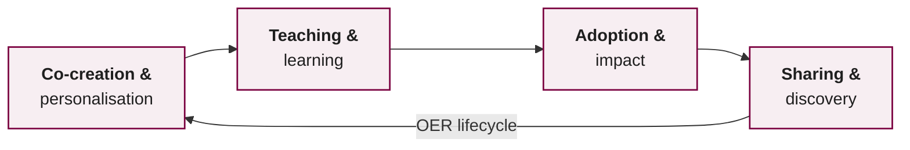
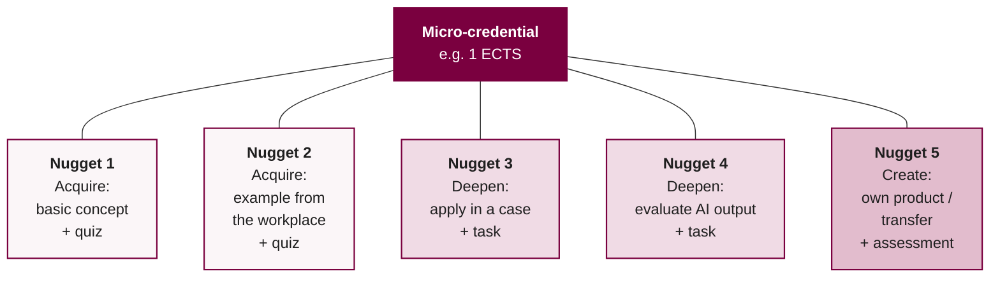

<!--
author:    Dr. Hannes Tegelbeckers
email:     hannes.tegelbeckers@ovgu.de
version:   1.2.1
language:  en
narrator:  UK English Female
mode:      Textbook

title:     S05 – Open education with AI: OER, licensing, micro-credentials (Self-learning unit)
comment:   AI in TVET I – Self-learning unit for session 5 (12.11.2026): Open Educational Resources, Creative Commons licensing and AI output, the European approach to micro-credentials, learning nuggets; draft of the own micro-credential.

import:    https://raw.githubusercontent.com/LiaTemplates/mermaid_template/0.1.4/README.md
-->

# S05 – Open Education with AI: OER, Licensing, Micro-credentials

> **Session 5 · 12.11.2026 · 🔵 Self-learning** – I am travelling; work through this unit on your own.
>
> **Time needed:** about 3 hours (incl. drafting your micro-credential)
>
> **Do the exercise in Moodle by 18.11.2026, 23:59** – see the last chapter: [Open the course in Moodle](https://elearning.ovgu.de/course/view.php?id=21948)

**After this unit you will be able to …**

1. explain what Open Educational Resources (OER) are and why they matter for TVET,
2. choose a suitable Creative Commons licence and attribute sources correctly,
3. assess the copyright status of AI-generated content and declare AI use,
4. describe a micro-credential with the elements of the European approach,
5. split your micro-credential into stackable learning nuggets.

## 1. Open Educational Resources (OER)

Most teaching material is protected by copyright: you may use it in your own class, but not change it and share it freely. **Open Educational Resources** remove these barriers – and they are the format in which your micro-credential nuggets will be published.

> **OER** are learning, teaching and research materials in any format that are in the public domain or published under an open licence that permits no-cost access, re-use, re-purposing, adaptation and redistribution by others (UNESCO, 2019).

### The 5R permissions (Wiley)

| R | Permission | Example |
| --- | --- | --- |
| **Retain** | Keep a copy | Download a LiaScript course |
| **Reuse** | Use it as it is | Use the course in your class |
| **Revise** | Change it | Adapt examples to your trade |
| **Remix** | Combine it with other material | Merge two nuggets |
| **Redistribute** | Share it | Publish your version on GitHub |

**Why OER in TVET?** Fast-changing technologies need constantly updated material; OER can be adapted to national regulations and translated – also with AI support.

**Example:** A teacher in Magdeburg publishes a LiaScript nugget on heat pumps under CC BY. A colleague in Vienna *revises* it for Austrian regulations, a trainer in a company *remixes* it with her own safety instructions, and both *redistribute* their versions. Without an open licence, each of them would have had to ask for permission – or start from scratch.

**Check:** A colleague adapts your OER nugget to another trade and combines it with her own exercises. Which two permissions does she use? (several answers)

- [[ ]] Retain
- [[X]] Revise
- [[X]] Remix
- [[ ]] Reuse

### AI-augmented OER

Gillet et al. (2024) distinguish **basic OER** (content to be consumed) from **rich OER**, which add a pedagogical structure (learning phases), learner outputs and learning analytics, and **AI support agents or chatbots**. Generative AI can explain terms on demand and generate tailored examples, exercises and formative feedback.



Despite the well-known concept, OER are still **scarce** in practice. The authors therefore stress the whole lifecycle – including incentives for teachers, links to curricula and participatory design with teachers (Gillet et al., 2024).

## 2. Creative Commons Licences

An open licence tells others in advance what they may do with your work – nobody has to ask you. Creative Commons (CC) licences are the standard for OER. They are built from four modules: **BY** (name the author), **SA** (share alike: adaptations under the same licence), **NC** (non-commercial use only) and **ND** (no derivatives: no changes). Always use the current version **4.0**.

| Licence | Meaning | OER? |
| --- | --- | --- |
| **CC0** | No rights reserved (public domain dedication) | ✔ |
| **CC BY** | Attribution required | ✔ (recommended) |
| **CC BY-SA** | Attribution + share alike (same licence for adaptations) | ✔ |
| **CC BY-NC** | Non-commercial only | limited |
| **CC BY-ND** | No derivatives (no changes) | ✘ (no revise/remix) |

### Attribution: TASL

Every re-used work needs **T**itle · **A**uthor · **S**ource (link) · **L**icence (link):

```text
"Weld seam inspection" by Jane Doe, https://example.org/photo, CC BY 4.0
(https://creativecommons.org/licenses/by/4.0/)
```

**Check:** You want learners and teachers to adapt your nuggets freely, also for company training. Which licence fits best?

- [( )] CC BY-NC-ND
- [(X)] CC BY
- [( )] All rights reserved

**Check:** You combine a CC BY-SA image with your own text. Under which licence must you publish the adapted image?

- [( )] Any licence
- [(X)] CC BY-SA (share alike)
- [( )] CC0

## 3. AI Output and Copyright

{{1}}
<section>

**What we know (status 2026)**

- Copyright protects **human** creative work. In the EU and the US, content generated purely by AI without sufficient human creative contribution is generally not protected (see U.S. Copyright Office, 2025).
- **Your** selection, arrangement and revision of AI output can be protected.
- Tool **terms of use** regulate what you may do with the output – read them.
- AI output can unintentionally reproduce protected material (text, images, logos). Check before publishing.
- The EU AI Act requires that synthetic content can be identified as AI-generated (transparency obligations, Art. 50).

</section>

### Declare your AI use

Add a short declaration to every OER you create with AI:

```text
Created with AI support (Claude, ChatGPT). All content was checked,
revised and selected by the author. Licence: CC BY 4.0.
```

**Check:** You let an LLM write a quiz, then you select 8 of 20 questions, rewrite them and arrange them into a nugget. What is most likely protected by copyright?

- [( )] The 20 raw questions generated by the AI
- [(X)] Your selection, revision and arrangement
- [( )] Nothing – AI was involved

**Reflection:** You generated an illustration with an image AI in the style of a well-known comic artist. Would you publish it in your OER? Why (not)? Note your answer in your AI tools log.

## 4. The European Approach to Micro-credentials

> A **micro-credential** is the record of the learning outcomes that a learner has acquired following a small volume of learning. These learning outcomes have been assessed against transparent and clearly defined standards (European Commission, 2021; Council of the European Union, 2022).

Micro-credentials are **owned by the learner**, can be shared and are portable (e.g. in a Europass digital wallet). They may be standalone or **stacked** into larger credentials – but whether to stack or recognise them is decided by the **receiving organisation** (European Commission, 2021).

**A global view:** UNESCO's expert consensus (47 experts) describes a micro-credential as a record of focused learning achievement, with assessment against clearly defined standards by a trusted provider, standalone value, and quality assurance (Oliver, 2022). The report also names open problems: many competing definitions, quality assurance outside regulated education, **little evidence so far that micro-credentials work** – and the risk that funding is diverted from formal education. Micro-credentials should *complement*, not replace, full qualifications.

### Mandatory elements (EU standard)

| Element | Example |
| --- | --- |
| Identification of the learner | Name |
| Title of the micro-credential | "AI-supported fault diagnosis in automotive electrics" |
| Country / region of the issuer | Germany, Saxony-Anhalt |
| Awarding body | OVGU Magdeburg |
| Date of issuing | 15.01.2027 |
| Learning outcomes | "Learners can use an AI assistant to …" |
| Notional workload (ECTS where possible) | 1 ECTS (25–30 h) |
| Level (EQF, if applicable) | EQF 4 |
| Type of assessment | Practical task + reflection |
| Form of participation | Online, self-paced |
| Type of quality assurance | Internal review by the university |

Optional elements include prerequisites, supervision and identity verification, grade, integration/stackability options and further information.

### The ten principles

The Council Recommendation (Council of the European Union, 2022) adds ten principles for the design and issuing of micro-credentials. They are the quality criteria against which the decision panel will judge your pitch.

| Principle | What it means for your micro-credential |
| --- | --- |
| **Quality** | The provider has internal and external quality assurance. |
| **Transparency** | Workload, outcomes, assessment and level are stated clearly (the mandatory elements). |
| **Relevance** | It addresses an identified need of the labour market or society – your **skill gap**. |
| **Valid assessment** | Learning outcomes are assessed against transparent standards. |
| **Learning pathways** | It can be stacked or combined with other credentials where possible. |
| **Recognition** | It states its purpose so that it can be recognised by employers and education providers. |
| **Portable** | It is owned by the learner and can be stored and shared, e.g. as a digital credential. |
| **Learner-centred** | It is designed for the needs of the target group and is updated with learner feedback. |
| **Authentic** | It carries information that makes it possible to check its identity, authenticity and issuer. |
| **Information and guidance** | Learners get information and advice on how to choose and use micro-credentials. |

**Check:** In your pitch you show job advertisements that ask for skills your micro-credential teaches. Which principle do you address mainly?

- [( )] Portable
- [(X)] Relevance
- [( )] Authentic

### Digital credentials

Paper certificates can be forged; digital credentials can be verified, shared and stored – and carry more information. Two important formats are **Open Badges 3.0** and the **European Learning Model (ELM)**, both based on W3C Verifiable Credentials (Delgado Kloos et al., 2025). This is where your optional badge (assessment component 3) fits in.

**Check:** Which of these is a **mandatory** element of the EU standard? (several answers)

- [[X]] Learning outcomes
- [[X]] Type of assessment
- [[ ]] Price of the course
- [[X]] Notional workload
- [[ ]] Name of the AI tool used

## 5. Learning Nuggets: Making Micro-credentials Modular

A **learning nugget** is a short, self-contained unit (about 5–15 minutes) with **one** learning objective. Several nuggets add up to the micro-credential.



**Design principles**

- one learning objective per nugget, formulated with an action verb (Bloom),
- an authentic example from the vocational field,
- at least one interactive element (quiz, task, reflection),
- a short summary and link to the next nugget,
- open licence and AI declaration.

**Example nugget plan:** micro-credential "AI-supported fault diagnosis in automotive electrics" (target group: 3rd-year apprentices, EQF 4)

| # | Level | Learning objective | Interactive element |
| --- | --- | --- | --- |
| 1 | Acquire | **Explain** how an AI diagnosis assistant reaches a suggestion | Single-choice quiz |
| 2 | Acquire | **Describe** typical errors of AI suggestions in vehicle diagnosis | Matching task |
| 3 | Deepen | **Apply** the assistant to a documented fault case | Case task with text input |
| 4 | Deepen | **Evaluate** an AI suggestion against the repair manual | Reflection with solution |
| 5 | Create | **Document** a diagnosis with AI use and own justification | Assessed practical task |

**Check:** Which learning objective is suitable for a single nugget?

- [( )] "Learners understand AI in the automotive sector."
- [(X)] "Learners can check an AI diagnosis suggestion against the repair manual."
- [( )] "Learners know everything about electric vehicles and AI."
[[?]] One objective, an observable action verb, a concrete context.

**How AI helps:** suggesting a nugget structure from your learning outcomes, drafting texts and quizzes, generating case variants, translating. **You** decide on objectives, check facts and ensure didactic quality.

**Two examples from research**

- **AI for the first draft:** Delgado Kloos et al. (2025) used several AI tools (e.g. ChatGPT, DeepSeek, NotebookLM) with context and examples to draft a university micro-credential design. Their conclusion: AI gives a useful *first draft*; refining it is an iterative process with the instructors.
- **AI for the skill gap:** For green upskilling in the urban renewable energy sector, De Rosa et al. (2024) analysed a large dataset of job descriptions with natural language processing, clustered the required skills and – co-designed with stakeholders – derived a basket of **74 stackable micro-credentials**. A model for how you can justify the skill gap in your pitch.

## 6. Exercise in Moodle for Session 5

**Do the exercise in Moodle by 18.11.2026, 23:59:** [Open the course in Moodle](https://elearning.ovgu.de/course/view.php?id=21948)

Enter your results in the fields below and submit each field. Moodle saves your progress. The exercise counts as done when you have completed this unit in Moodle by the deadline – no file upload is needed.

**1 · Micro-credential draft** – all mandatory elements of the EU standard (section 4), one line per element:

[[___ ___ ___ ___ ___ ___ ___ ___ ___ ___ ___]]

**2 · Nugget plan** – 3–6 nuggets, each with level (Acquire / Deepen / Create), one learning objective and the planned interactive element (see the example in section 5):

[[___ ___ ___ ___ ___ ___]]

**3 · First nugget draft** – the LiaScript link or GitHub link to your first nugget (it does not need to be finished), and the licence you chose:

[[___ ___]]

**4 · AI tools log** – at least **3 entries** from this unit (tool, purpose, prompt, what you checked or changed):

[[___ ___ ___ ___ ___]]

In the live session on **19.11.2026** you pitch your micro-credential (10 minutes + 3 minutes questions). Unit S06 helps you build the LiaScript files and the pitch.

## References

- Council of the European Union. (2022). *Council Recommendation of 16 June 2022 on a European approach to micro-credentials for lifelong learning and employability* (2022/C 243/02). Official Journal of the European Union. https://eur-lex.europa.eu/legal-content/EN/TXT/?uri=CELEX:32022H0627(02)
- Creative Commons. (n.d.). *About CC licenses*. https://creativecommons.org/share-your-work/cclicenses/
- De Rosa, M., Glumac, O., Bianco, V., & Pallonetto, F. (2024). A micro-credential approach for life-long learning in the urban renewable energy sector. *Renewable Energy, 228*, 120660. https://doi.org/10.1016/j.renene.2024.120660
- Delgado Kloos, C., Alario-Hoyos, C., & Kemcha, R. (2025). How challenges become opportunities: Micro-credentials and artificial intelligence. In *2025 IEEE Global Engineering Education Conference (EDUCON)*. IEEE. https://doi.org/10.1109/EDUCON62633.2025.11016509
- European Commission. (2021). *A European approach to micro-credentials* [Factsheet]. Publications Office of the European Union.
- European Union. (2024). *Regulation (EU) 2024/1689 (Artificial Intelligence Act)*. https://eur-lex.europa.eu/eli/reg/2024/1689/oj
- Gillet, D., Notari, M., Spaenlehauer, B., & Reidy, T. (2024). Implementation framework and strategies for AI-augmented open educational resources (OER): A comprehensive approach applied to secondary and higher education. In *2024 21st International Conference on Information Technology Based Higher Education and Training (ITHET)*. IEEE. https://doi.org/10.1109/ITHET61869.2024.10837633
- Oliver, B. (2022). *Towards a common definition of micro-credentials*. UNESCO. https://unesdoc.unesco.org/ark:/48223/pf0000381668
- UNESCO. (2019). *Recommendation on Open Educational Resources (OER)*. https://www.unesco.org/en/legal-affairs/recommendation-open-educational-resources-oer
- U.S. Copyright Office. (2025). *Copyright and artificial intelligence, Part 2: Copyrightability*. https://www.copyright.gov/ai/
- Wiley, D. (n.d.). *Defining the "open" in open content and open educational resources*. https://opencontent.org/definition/

<small>Licence: CC BY 4.0 · Dr. Hannes Tegelbeckers, OVGU Magdeburg · Created with AI support (Claude), checked and revised by the author.</small>
